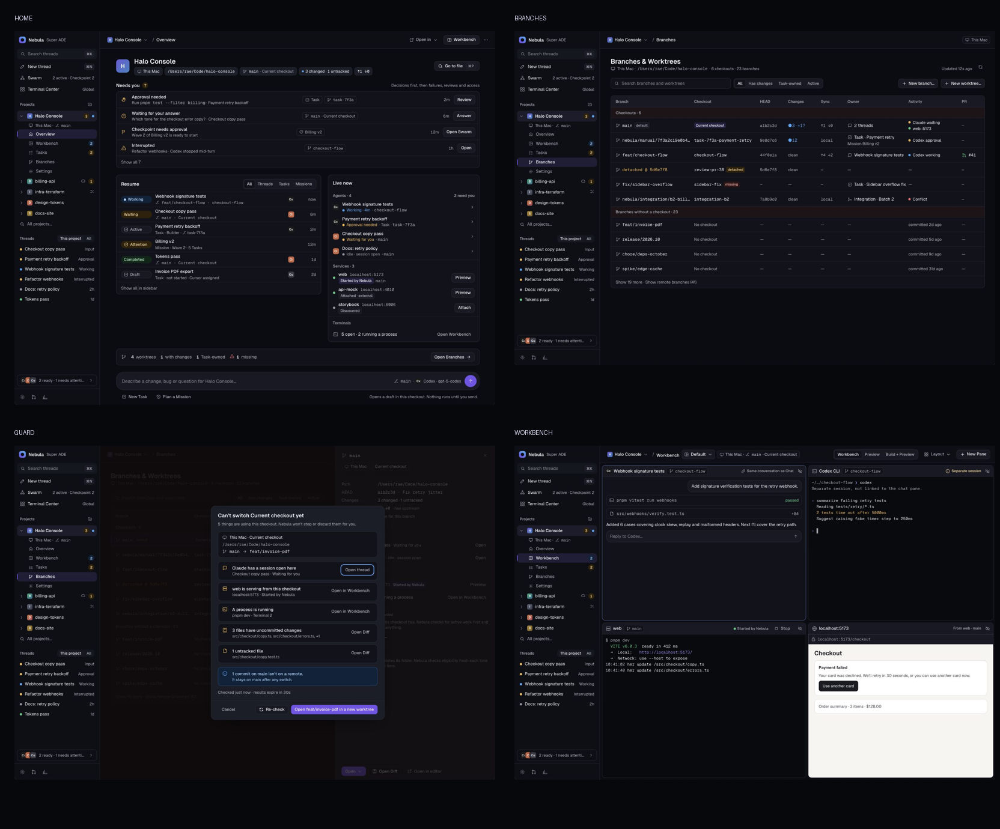

# Project OS visual artifacts

All screens use synthetic Halo Console data. They are design references, not live application evidence. The editable [HTML reviewer](reference/project-os.html?review=1) supports every required CSS width; the [full atlas](reference/project-os.html) carries loading, empty, partial error, offline, safety and Notes placement states.

| Screen                              | Ion dark                                          | Ion light                                          | Narrow (390 CSS px)                             |
| ----------------------------------- | ------------------------------------------------- | -------------------------------------------------- | ----------------------------------------------- |
| Project Home / Overview             | [1440](reference/screens/home-dark-1440.png)      | [1440](reference/screens/home-light-1440.png)      | [390](reference/screens/home-dark-390.png)      |
| Branches & Worktrees                | [1440](reference/screens/branches-dark-1440.png)  | [1440](reference/screens/branches-light-1440.png)  | [390](reference/screens/branches-dark-390.png)  |
| Worktree detail / guarded switching | [1440](reference/screens/guard-dark-1440.png)     | [1440](reference/screens/guard-light-1440.png)     | [390](reference/screens/guard-dark-390.png)     |
| Project Workbench                   | [1440](reference/screens/workbench-dark-1440.png) | [1440](reference/screens/workbench-light-1440.png) | [390](reference/screens/workbench-dark-390.png) |

Additional views: [expanded sidebar](reference/screens/sidebar-dark-768.png), [ultrawide Workbench](reference/screens/workbench-dark-2560.png), [shipped dark theme](reference/screens/home-shipped-dark-1440.png), [shipped light theme](reference/screens/home-shipped-light-1440.png), [200% text at 390](reference/screens/home-light-text200-390.png).

Screens are cropped from the in-app browser. Logical frame widths use CSS pixels. Large frames scale to fit the review canvas; use 100% in the atlas for pixel inspection. Provider initials and project monograms are labelled design placeholders; the foundation’s approved production asset gate still applies.
