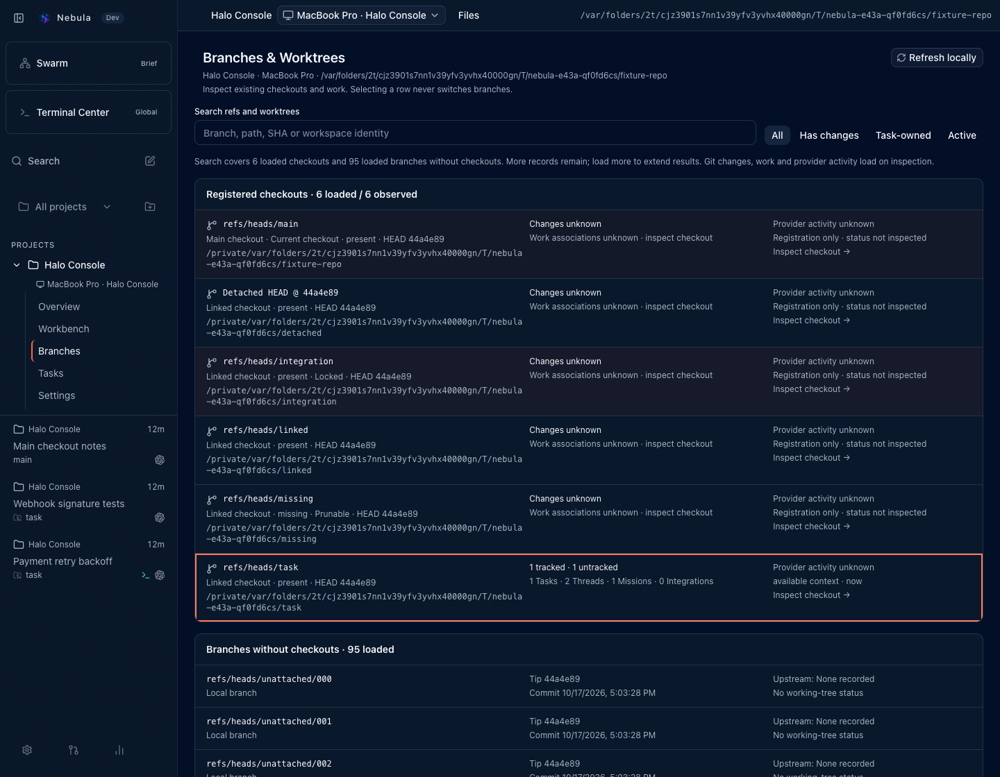
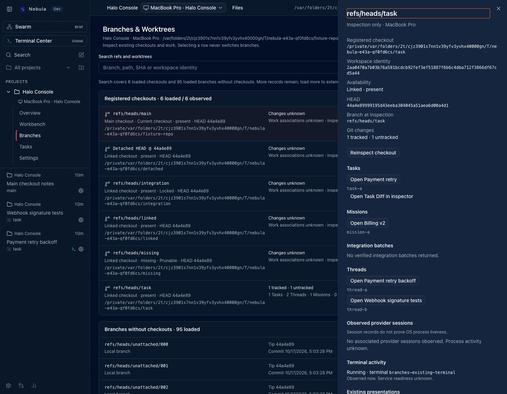

# Branches & Worktrees

Open **Branches** in the active Project sidebar to inspect the selected physical Project on its
selected host. The route is `/projects/$projectKey/branches`; its `checkout` selector follows the
same [Project navigation contract](../nebula/PROJECT_NAVIGATION.md) as Overview and Workbench.
Reload and browser Back/Forward preserve that selection. Invalid selections stay unavailable.
Selecting a row or pressing Enter opens inspection and never switches a checkout.

## Checkouts and branches

Registered checkouts appear first, with the main checkout first and the Project's current checkout
identified explicitly. Registration, path, branch or detached HEAD, abbreviated HEAD, missing paths,
locks and prunable registrations come from the [canonical inventory](../nebula/PROJECT_INVENTORY.md).
Registration does not establish execution safety. Dirty state and work associations are unknown
until the checkout is inspected; the page does not scan every checkout or poll Git in the background.

Branches without registered checkouts appear separately, local branches first. They have full ref
identity, tip SHA, nullable commit time and upstream identity. They have no working-tree clean/dirty
state, inferred owner, sync count, PR status or service-health claim. **Include remote-tracking refs**
explicitly expands the local observation; it does not contact the remote.

Search applies to loaded refs and checkout records. **Load next page** extends those results, at up
to 100 refs and 100 checkouts per request. Empty search results describe loaded observations only.
A partially bounded scan reports lower-bound counts. Exhausting the cursor does not make a
truncated source exhaustive. A stale cursor discards previous pages and restarts from page one
with a notification. A second stale cursor pauses pagination until an explicit refresh.

**Has changes** and **Task-owned** use inspected facts. **Active** identifies observed ready/running
provider records; it does not prove OS process liveness or process idleness. Uninspected or partial
checkouts remain explicitly unknown under these filters. Branch-only records do not participate in
checkout filters. **Refresh locally** replaces the observation and clears inspected context. It never
runs remote `git fetch`. Source timestamps and completeness remain visible in inspection.

## Inspecting existing work

The detail sheet asks the selected server to verify the opaque workspace key. It shows fresh local
tracked/untracked counts, canonical Task, Mission, Integration and Thread associations, and observed
provider sessions. Multiple Threads may use one checkout. Ambiguous ownership retains every returned
claim, with an explicit warning, rather than selecting an exclusive owner. Missing paths, repository
mismatches, changed branches and partial observations remain visible with recovery explanations.

Task and Mission links open their existing canonical surfaces. Task Diff opens the existing Task
inspector, which includes its Diff panel. Integration links open the existing Integration section;
that destination does not yet select an individual batch by URL. Thread links open the original
Thread on its original host.

Saved Workbench, Diff and Preview presentations are offered only for exact server-verified paths
with compatible declared Task/Thread bindings. Opening one changes local presentation selection
and uses `inspect=true` on Workbench. It restores an existing Preview or shows it as unavailable;
it never creates a pane, fake Thread, terminal, provider session or browser runtime on navigation.
If no presentation exists, the sheet says so and offers the verified work links that are available.

## Permissions, offline state and accessibility

Inventory and workspace inspection require `orchestration:read` and advertised `projectInventory`
capability. Older hosts receive an explanatory unavailable state. Terminal observations additionally
require the existing `terminal:operate` permission. Shared sidebar and terminal-session hooks also
respect that permission, so an inspection-only credential does not subscribe to protected metadata.
The inventory composite itself still has no terminal access. Existing server authorization is unchanged.

An offline host retains only explicitly labelled in-memory inventory for its own physical identity,
when available. Current status/activity are unknown; refresh and navigation actions are disabled.
This bounded display cache survives navigation in the current client, not a cold offline reload.
It does not substitute another host or Project. Reconnect or explicitly choose another checkout.

Rows support Tab, Up/Down and Home/End; Enter inspects. Escape closes the sheet and restores row
focus. Status uses text, names and headings alongside theme colors. Rows and pagination wrap on
narrow screens and enlarged text; the sheet respects reduced motion. Real VoiceOver and founder
visual acceptance remain human review gates.

This milestone has no New Thread Here, branch/worktree creation, checkout switch, removal,
provider/terminal lifecycle controls or setup action. Creation requires E4.3B's exact-context flow.
Switching/removal remain subject to [checkout safety](../nebula/PROJECT_INVENTORY.md#subsequent-milestones-and-e44-boundary)
and E4.4's shared server coordination; display selectors never authorize those operations.

## Example

Synthetic Project inventory and checkout inspection in the shipped dark theme:

